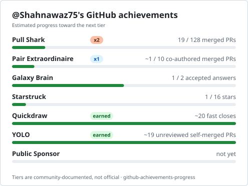

<!-- ANIMATED HEADER WITH TYPING EFFECT OR SUBTLE GLOW -->

  
<i>Building enterprise software, modern web apps, and on-device AI/ML.</i>

  
  

    <a href="https://www.linkedin.com/in/shahnawazs/">LinkedIn</a> •
    <a href="https://github.com/Shahnawaz75">GitHub</a>
  

---

### 💻 Profile

Focused Software Engineer with extensive experience in backend systems, custom web applications, and database management. Specialized in **Flutter/Dart mobile development** and integrating **on-device AI/ML** models for computer vision and real-time processing.

- **Mobile AI:** YOLO, MediaPipe Face Mesh, CameraX, Flutter/Dart
- **Backend/Web:** C# (.NET), Python, Node.js, JS/TS, HTML5, CSS Grid/Flexbox
- **Databases:** SQL Server, PostgreSQL, Firebase (Realtime DB)
- **Specialty:** Industrial Offline Systems, Web Scraping, OCR, REST APIs

---

### 🚀 Featured live apps & projects

<!-- CAPSULE RENDER HEADERS CAN CREATE A COOL, ANIMATED SPLASH -->

- **[Ultra Scan 4D](https://play.google.com/store/apps/details?id=com.app.ultrascan4d&hl=en)** — Mobile Healthcare AI app with a custom YOLO-based computer vision model for real-time, on-device hair and skin analysis.
- **[Leader Schedulers](https://play.google.com/store/apps/details?id=com.app.leaderschedulers&hl=en)** — Complete mobile frontend development for production productivity and schedule management.
- **Orixont (OrionXT)** — Smart self-and-product retail management app designed for shelf tracking, inventory, and store management.
- **AI Classroom Attendance App** — Real-time face recognition system using CameraX, MediaPipe Face Mesh, and L2 distance vector matching.
- **Digicut & Real Estate** — Industrial offline-first factory system and modern responsive real-estate web solutions ([haestate.com](https://haestate.com)).

---

### 🛠️ Tech stack

<!-- GLASSMORPHISM EFFECT STYLE (USING FOR-THE-BADGE & PADDING) -->

  
  
  
  
  
  
  
  

---

### 📊 Activity & overview

  <!-- STATS CARD WITH SLOW WAVE ANIMATION OR GRADIENT -->
  
  

 

  <!-- SUBTLE STREAK ANIMATION -->
  

---

### 🏆 GitHub achievements progress

  <a href="https://github.com/Shahnawaz75/github-achievements-progress">
    <picture>
      <source media="(prefers-color-scheme: dark)" srcset="achievements-dark.svg">
      
    </picture>
  </a>
  
Updated daily by <a href="https://github.com/Shahnawaz75/github-achievements-progress">github-achievements-progress</a>, a free tool that shows how close you are to every GitHub badge.

---

### 🧰 Free open source tools I made

- **[github-achievements-progress](https://github.com/Shahnawaz75/github-achievements-progress)**: see how close you are to the next tier of every GitHub achievement, and why a badge didn't unlock.
- **[pyinstaller-doctor](https://github.com/Shahnawaz75/pyinstaller-doctor)**: find out why your PyInstaller exe fails and get the exact fix.
- **[pip-conflict-explainer](https://github.com/Shahnawaz75/pip-conflict-explainer)**: explains pip dependency conflicts (ResolutionImpossible) in plain words.
- **[windows-long-path-doctor](https://github.com/Shahnawaz75/windows-long-path-doctor)**: finds and fixes "Filename too long" problems on Windows.
- **[excel-link-finder](https://github.com/Shahnawaz75/excel-link-finder)**: finds the external links in Excel workbooks that "Break Links" can't remove.
- **[dxf-diff](https://github.com/Shahnawaz75/dxf-diff)**: compare two DXF drawing revisions and see what changed.
- **[dxf-takeoff](https://github.com/Shahnawaz75/dxf-takeoff)**: quantity takeoff from DXF drawings (counts, lengths, areas).
- **[svg-to-dxf](https://github.com/Shahnawaz75/svg-to-dxf)**: convert SVG to DXF at the right size for laser cutting and CNC.
